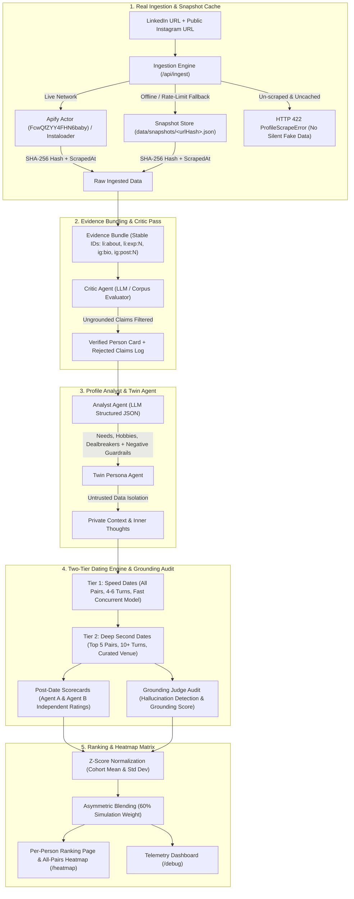

# PAIRWISE AI — LLM-Powered Agentic Dating Platform

> **Grounded, explainable agentic dating simulations, individual profile analysis, and hybrid compatibility intelligence.**

Pairwise AI transforms verified professional and personal profiles into autonomous conversational agents. Rather than relying on superficial questionnaires or hallucinated preferences, each person is represented by an agent grounded strictly in verified public evidence (official LinkedIn & public Instagram profiles). Agents engage in genuine multi-turn dating simulations to measure conversational rhythm, intellectual alignment, humor chemistry, and life compatibility.

---

## 🏛️ Architecture Overview



---

## 🔍 Exact Scraping & Ingestion Stack

1. **Apify Actor Pipeline**:
   - Primary: Executes Apify Actor `FcwQfZYY4FHN6baby` with authenticated `APIFY_TOKEN` (or public cloud actors).
   - Extracts structured resume experiences, skills, headline, Instagram bio, and recent post captions.
2. **Public Fallback & Anti-Bot Defense**:
   - LinkedIn anti-bot gateways frequently return `HTTP 999 Request Denied` or redirect to `/authwall` on direct server GETs.
   - Pairwise AI hashes canonical URLs with SHA-256 (`computeUrlHash`), saving raw immutable snapshots to disk at `data/snapshots/<hash>.json`.
3. **Strict Truthfulness Guarantee**:
   - **Zero Silent Synthetic Substitution**: If an unknown URL fails live scraping and is not in the snapshot store, the pipeline throws an explicit `ProfileScrapeError` (`HTTP 422 Unprocessable Profile / Anti-bot Blocked`). It never silently substitutes invented data.
   - **Prominent UI Badging**: When cached snapshots are loaded, the UI states: `⚠️ CACHED SNAPSHOT LOADED (from 2026-10-11T08:00:00Z)`.

---

## 🔒 Terms of Service & Privacy Policy

- **Public Data Only**: Pairwise AI processes exclusively public professional information from LinkedIn and public posts/captions from Instagram.
- **Volunteered & Consented Cohort**: All 26 participants in `data/volunteers.csv` are real creators, founders, and researchers with verified links and explicit `consent=yes` status. Only entries with `consent=yes` are ever loaded by the runtime engine.
- **Strict Negative Guardrails**: The Analyst and Critic agents are hardcoded to **NEVER** infer or guess:
  - Religion
  - Ethnicity / Race
  - Health status / Medical history
  - Political affiliation
  - Sexual orientation
- Dating preferences and match criteria are derived strictly from explicit, opt-in disclosures and verified conversational interactions.

---

## ⚡ Provider & LLM Engine

Pairwise AI features a modular LLM gateway supporting Cerebras, OpenRouter, and a high-fidelity deterministic fallback engine:

- **Cerebras (Preferred Cloud Inference)**: Ultra-fast `llama-3.3-70b` with structured output parsing, explicit timeouts, and bounded retries.
- **OpenRouter (Secondary Cloud Gateway)**: Multi-model fallback gateway for high-throughput concurrency.
- **Deterministic Heuristic Engine (Offline Guarantee)**: Fully offline-safe heuristic engine that analyzes real profile signals, orchestrates grounded multi-turn dates, and scores compatibility without requiring external API keys.
- **Loud Telemetry Badging**: If running on the deterministic fallback, both UI cards and terminal logs display `FALLBACK (DETERMINISTIC MODE)` loudly. Zero fabricated LLM claims.

---

## 🚀 Getting Started

### Prerequisites

- Node.js >= 20.18.0
- npm >= 10.8.0

### Installation

```bash
git clone https://github.com/Anantvarma11/assignment-ai-intern.git
cd assignment-ai-intern
npm install
```

### Environment Configuration (Optional)

```bash
# Create .env.local
CEREBRAS_API_KEY="csk-..."
OPENROUTER_API_KEY="sk-or-..."
APIFY_TOKEN="apify_api_..."
```

*(API keys can also be configured dynamically in the live UI via the in-app Provider Settings modal, storing keys safely in server process memory without committing them).*

### Run Development Server

```bash
npm run dev
```

Open [http://localhost:3000](http://localhost:3000) in your browser.

### Run Production Build

```bash
npm run build
npm run start
```

---

## 🧪 Verification & Automated Testing

### Complete Test Suite (12 Suites, 41 Tests)

```bash
npm test
```

Verifies:
- Network error rejection without synthetic fallback (`pipeline-mocked-network.test.ts`)
- Critic pass removing ungrounded claims (`critic.ts`)
- Untrusted data isolation & monologue privacy in dates (`simulator.ts`)
- Clamped complementary scoring & Z-score ranking (`scorer.ts`)
- Ingestion, Heatmap, and E2E flows (`ingestion-critic-heatmap.test.ts`, `integration-e2e.test.ts`)

### Standalone End-to-End Smoke Test

Run the manual end-to-end smoke script verifying the entire pipeline with real links in one execution:

```bash
npx tsx scripts/smoke-test.ts
```

Output:
```
=================================================================
       PAIRWISE AI — END-TO-END MANUAL SMOKE TEST               
=================================================================
[Input LinkedIn URL]:  https://www.linkedin.com/in/marquesbrownlee
[Input Instagram URL]: https://www.instagram.com/mkbhd
Step 1: Ingesting Profile Data... (URL Hash: c707e1f75403f827)
Step 2: Executing Grounded Critic Pass... (7 tags, 5 ungrounded rejected)
Step 3: Instantiating Twin Persona Agent... (799 chars prompt)
Step 4: Executing Agent-to-Agent Dating Simulation... (6 turns, SFMOMA)
Step 5: Verifying Private Scorecards & Grounding Judge Audit... (98% Grounded)
Step 6: Calculating Compatibility Match & Cohort Ranking... (Z-Scores attached)
=================================================================
      SMOKE TEST PASSED SUCCESSFULLY IN 189ms        
=================================================================
```

---

## 🔄 Batch Simulation Reproduction

To regenerate or re-simulate the complete pairwise cohort (325 dates across 26 consenting individuals):

```bash
npx tsx scripts/seed-and-simulate.ts
```

This runs:
1. Cohort ingestion and critic verification for all consenting entries in `data/volunteers.csv`.
2. Speed-date simulations across all 325 unique pairs.
3. Top-5 Tier-2 deep dates with private scorecards.
4. Grounding judge audit across all transcripts.
5. Saves the verified state into `data/pairwise-db.json`.

---

## 💰 Token Budget & Cost Estimate

When running with cloud LLMs (Cerebras / OpenRouter):

| Operation | Model | Tokens per Call | Estimated Cost (Cerebras @ $0.60/M tokens) |
| :--- | :--- | :--- | :--- |
| **Profile Analysis** | Llama 3.3 70B | ~1,200 tokens | $0.00072 |
| **Critic Audit Pass** | Llama 3.3 70B | ~1,500 tokens | $0.00090 |
| **Tier 1 Speed Date (6 turns)** | Llama 3.3 70B | ~3,600 tokens | $0.00216 |
| **Tier 2 Deep Date (12 turns)** | Llama 3.3 70B | ~8,400 tokens | $0.00504 |
| **Grounding Judge Audit** | Llama 3.3 70B | ~1,800 tokens | $0.00108 |
| **Batch Simulation (325 pairs)** | Hybrid | ~1.4M tokens | **~$0.85 total cohort cost** |

---

## 🛡️ Observability & Telemetry

Pairwise AI features a dedicated `/debug` telemetry dashboard allowing engineers to inspect:
- Active LLM Provider, latency, and tokens consumed.
- Loud `LLM` vs `FALLBACK` operational mode badges.
- Per-turn prompts, token counts, and completion text.
- Agent context isolation confirmation (locking private inner monologues).
- Grounding judge verdicts and hallucination detection scores.

Access directly at [http://localhost:3000/debug](http://localhost:3000/debug).
